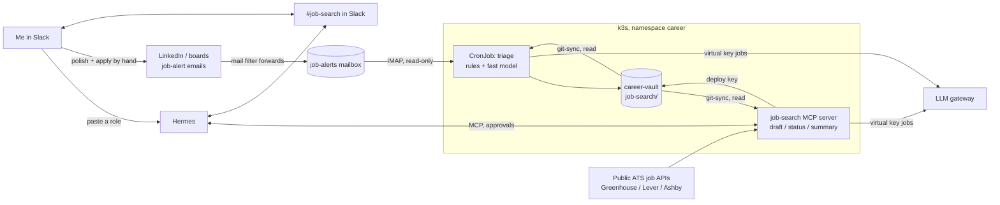

# Job-search agent design

Status: **design, not built.** The decision is [ADR-0036](../../decisions/0036-job-search-agent-finds-human-applies.md); the portable idea is the [agent finds, human acts](../../patterns/agent-finds-human-acts.md) pattern. Everything personal (profile, CV, roles, drafts) lives in the private `career-vault`; this page only describes the machinery.

## What it does, in one day

1. LinkedIn (Premium Career) and other boards email job alerts. A mail filter forwards them to a dedicated job-alerts mailbox.
2. At 07:00 a CronJob reads new alerts, drops the obvious misses with plain rules, scores the rest against my profile with a cheap model, and writes the day's digest into the vault.
3. At 07:30 Hermes posts the top five in `#job-search`: title, company, location, score, two lines of why, and the biggest gap.
4. From my phone I reply in the thread: `draft 2`, `applied 3`, or nothing (nothing means skip).
5. `draft 2` asks for one **Allow once**, then the crew fetches the full description, writes a tailored CV summary and cover note into the vault, checks every claim against my CV, and Hermes replies with a short preview.
6. In Obsidian I polish the draft, read LinkedIn's own match insights, and apply myself. Then `applied 2` in Slack (one Allow once) moves the role's status.
7. On Fridays Hermes posts the pipeline: counts by status and applications with no reply after 10 days.



## Components

| Piece | Where | Does | Never does |
|---|---|---|---|
| Mail filter | My main mailbox | Forwards alert emails (by sender) to the job-alerts mailbox | Forward anything else |
| Job-alerts mailbox | Free email account | Holds alerts; app password for IMAP | Hold anything but alerts |
| `job-triage` CronJob | `career` ns, daily | Parse alerts, rule filter, score with `fast`, write `digests/YYYY-MM-DD.md` | Talk to Slack or LinkedIn |
| `job-search` MCP server | `career` ns, Deployment | Tools below; CrewAI for drafting | Submit, message anyone, answer salary/right-to-work |
| Hermes | `hermes` ns (exists) | Daily post, thread replies, approvals | Hold the mailbox or vault credentials |
| `career-vault` | Private repo, Obsidian | Profile, digests, role files, drafts; status tracker | Get copied to a public repo |

Code lives in `homelab-agents` (public: it's a portfolio piece), deployed by Argo CD from `homelab-gitops` in an AppProject `career`. It reuses the SRE crews' image base and conventions, with its own entry points. Nothing personal is in either repo; the criteria come from the vault at runtime.

## Tools on the `job-search` MCP server

| Tool | Hint | Approval in Hermes | Writes |
|---|---|---|---|
| `todays_matches()` | read-only | none; the cron uses it | nothing |
| `score_role(text_or_url)` | read-only | none | nothing (returns a score for a role I paste) |
| `draft_application(role_id)` | write | **Allow once** | `roles/<id>.md` and `drafts/<id>.md` |
| `set_status(role_id, status, note)` | write | **Allow once** | `roles/<id>.md` frontmatter |
| `pipeline_summary()` | read-only | none; the Friday cron uses it | nothing |

Hermes lists the server with `trust: untrusted` in its managed config, as for the SRE crews, so read-only tools run unprompted and write tools ask; cron sessions can't call write tools. `score_role` fetches a URL only if it's on a public ATS domain; a LinkedIn link is refused with "paste the description instead".

## Scoring

- **Rules first (no model):** location or remote policy, seniority words in the title, excluded industries or companies, already seen (role ID in an earlier digest or role file). Typically removes most of an alert.
- **Model second:** `fast` alias, one call per role, JSON out: `score` 0–100, `why` (two lines), `gaps`, `must_ask` (things to check before applying). The rubric and weights live in `career-vault/job-search/profile.md`, so tuning is a vault edit, not a deploy.
- **Shortlist:** score ≥ 70, at most five a day. The rest stay in the digest for the record.
- **Full description:** fetched only when I ask for a draft, from the employer's public ATS API matched by company and title, otherwise Hermes asks me to paste it.

## Drafting crew (on `draft 2`)

Three agents, sequential, `memory=False`, like `investigate_alert`:

1. **Analyst** (`fast`): pulls the role's must-haves and the five things it cares about most.
2. **Writer** (`reason`): a tailored CV summary (5–6 lines), three bullet rewrites, a cover note under 200 words. Only from `cv.md` and `profile.md`.
3. **Checker** (`fast`): lists every claim in the draft with the CV line that supports it; unsupported claims go in a `⚠ Check` box at the top. Salary, right to work, notice period and availability are always `[[YOU FILL]]`.

## Career-vault layout (private)

```
career-vault/job-search/
├── profile.md            # criteria, rubric weights, exclusions (frontmatter + prose)
├── cv.md                 # the source of truth for every claim
├── digests/2026-11-14.md # everything triaged that day, with scores (dedupe source)
├── roles/<id>.md         # one per role I act on; frontmatter is the tracker
└── drafts/<id>.md        # CV summary, bullets, cover note, ⚠ Check box
```

Role frontmatter: `company`, `title`, `source`, `source_id`, `url`, `score`, `status` (`shortlisted → drafted → applied → interviewing → offer | rejected | withdrawn | closed`), `applied`, `next_action`, `next_action_date`. An Obsidian Base over `roles/` is the board. Git history is the audit log; there's no database to back up.

## Privacy and terms

| Risk | Control |
|---|---|
| LinkedIn terms (no bots, scraping, automated access) | No tool calls LinkedIn; NetworkPolicy egress allows only DNS, the gateway, the mailbox's IMAP host, GitHub and the ATS API hosts |
| Misstatements under my name | No submit tools; Checker step; personal facts left as `[[YOU FILL]]` |
| Mailbox credential scope | Dedicated mailbox with alerts only; IMAP read with `BODY.PEEK` (doesn't even mark mail read) |
| CV text at model providers | `jobs` virtual key routes only to providers that don't train on or retain prompts (OpenRouter data-collection deny); budget 3 USD / 30 days; switch to `local` later |
| CV text in traces | Message logging off for the `jobs` key; Langfuse Cloud gets cost, latency and token counts only |
| Vault write credential | Write deploy key on `career-vault` only, SOPS-encrypted, mounted only in the `job-search` pod; server writes only under `job-search/` |
| Personal data in public repos | Criteria and CV only in the vault; code and this page are generic |

## Rough cost (estimate, not measured)

About 40 alerts a day, about 15 left after rules, about 2k tokens each on `fast` is ~30k tokens a day; three drafts a week on `reason` at ~15k tokens each. With current cheap models that's well under 2 USD a month; the 3 USD key budget is the hard stop. Measure in the first week of the playbook run and record it here.

## Open questions (for Shawn)

| Question | Options | Leaning |
|---|---|---|
| How alerts reach the agent | (a) a new Gmail used only for alerts, read over IMAP with an app password, fed by forwarding; (b) Gmail API on a main mailbox; (c) paste in Slack | (a) plus (c). The LinkedIn account's email is on Yahoo, where automatic forwarding may need Yahoo Mail Plus: if so, either pay for it, or send other boards' alerts straight to the new Gmail and share LinkedIn roles by hand. Never read the Yahoo mailbox itself, and don't make the alert mailbox the LinkedIn primary email (password resets). Gmail and Yahoo allow app passwords; Outlook.com needs OAuth |
| Where the agent writes drafts | `main` under `job-search/` (Obsidian sees them at once) vs a `job-search` branch I merge | `main`: drafts are private and reversible, and a branch adds friction every day |
| Company watchlist | Also poll a short list of target companies' public ATS boards daily | Later, once the alert-based flow is tuned |
| More sources | Alert emails from other boards (no work); boards with an official API or RSS (e.g. Adzuna, remote-focused boards), each checked against its terms first. No paid LinkedIn plan adds an API for job seekers, so Premium Career stays a human-side tool | Add alert emails now, APIs after the first week |
| Daily post time and cap | 07:30, top five | As proposed, adjust after a week |
| Interview prep | A `prep_interview(role_id)` tool that drafts likely questions and STAR stories from the vault | Next iteration |

## How it gets built

[Playbook 09](https://github.com/ssaav5-ai-labs/handbook/blob/main/playbooks/09-job-search/PLAYBOOK.md) builds it in an order that doesn't need the mailbox until the end: vault scaffold and profile, the `jobs` gateway key, the code, a check of the scorer against ten roles rated by hand, the deployment, Hermes in Slack, the Friday pipeline, then the daily email feed (deferrable), drills and finish.
