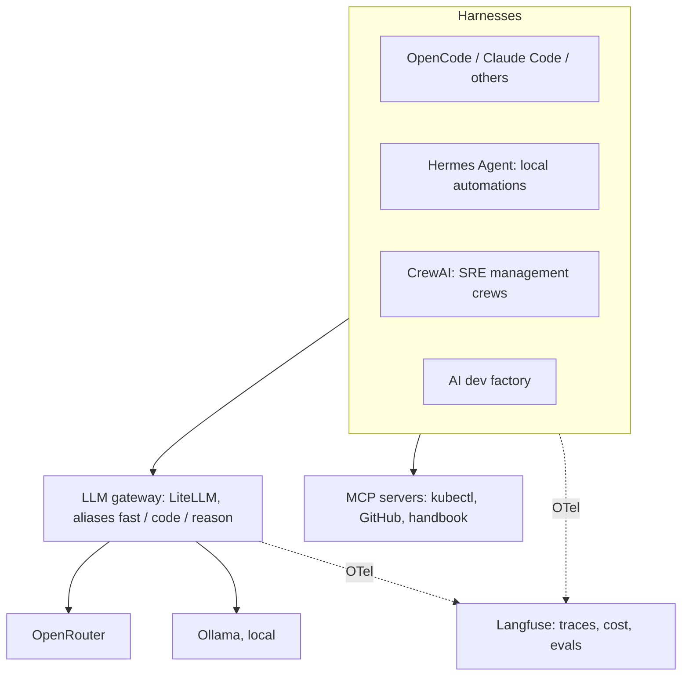

# AI tooling stack

## Rule zero: depend on standards, not products

Every piece below can be swapped, because the stack only depends on open interfaces:

| Concern | Standard we code against | Products are just implementations |
|---|---|---|
| Calling models | OpenAI-compatible API, through **our own gateway** with model **aliases** | OpenRouter, direct providers, Ollama |
| Agent instructions | `AGENTS.md` (Claude Code reads it via a one-line `CLAUDE.md`: `@AGENTS.md`) | OpenCode, Codex, Cursor, Copilot, Claude Code, Hermes |
| Reusable agent abilities | Agent Skills (`SKILL.md` folders) | Same harnesses; Hermes says it's agentskills.io-compatible |
| Tools and data access | MCP servers | Any MCP-capable harness or framework |
| Traces, cost, evals | OpenTelemetry | Langfuse, LangSmith, Grafana |
| Dev environments | `devcontainer.json` | DevPod, VS Code, Codespaces, JetBrains |

## Layers

### 1. Model access: OpenRouter behind your own gateway
- **OpenRouter** gives one key and one bill for hundreds of models, including cheap open-weight ones. It charges a 5.5% fee on credit purchases and keeps only metadata by default ([pricing/FAQ](https://openrouter.ai/docs/cookbook/coding-agents/claude-code-integration)).
- **Don't point tools at OpenRouter directly.** Put a **LiteLLM** proxy in front (a container on the laptop now, on k3s later). Tools call `http://llm-gateway/v1` with **aliases** instead of vendor model names:
  - `fast`: cheap model for summaries, journaling, classification
  - `code`: strong, cost-competitive coding model
  - `reason`: frontier model for planning and review, used sparingly
  - `local`: Ollama model for offline or private work
- Swapping a model or leaving OpenRouter becomes a gateway config change. The gateway also gives per-key budgets, spend tracking and traces, which is good SRE practice and good portfolio material.
- Pin the gateway image to a specific version or digest and update deliberately; it holds every API key.

### 2. Coding harness
- **Default: OpenCode** (open source, any OpenAI-compatible provider, reads `AGENTS.md` and skills). It works with every alias, so cheap models are the default.
- **Claude Code** remains an option, but through OpenRouter it only supports Anthropic models ([OpenRouter docs](https://openrouter.ai/docs/cookbook/coding-agents/claude-code-integration)). Treat it as one harness among several, never a dependency.
- Playbooks, skills and `AGENTS.md` are written so any harness can run them.

### 3. Local automation: Hermes Agent (recommended, with guardrails)
See [ADR-0009](../../decisions/0009-hermes-for-local-automation.md). Fits well: MIT license, any provider including OpenRouter and custom endpoints (point it at the gateway), MCP, agentskills.io-compatible skills, built-in cron, chat gateways (Telegram, Slack, Discord and others), Docker/SSH terminal backends, native Windows ([repo](https://github.com/NousResearch/hermes-agent)).

What to consider:
- **Blast radius.** It's a long-running agent with broad permissions. Run it in a container, use the **Docker terminal backend**, keep command approval on, give it scoped tokens (read-only kubeconfig to start), and never your personal GitHub token.
- **Self-written skills are knowledge.** Hermes writes skills from experience. Point its skills directory at a git repo and review them via PR, so learned skills become portable assets in the handbook rather than hidden state.
- **Memory lives in SQLite**, not Markdown. Treat it as a cache; anything worth keeping gets promoted to the handbook.
- **Deterministic vs agentic.** Use plain cron/GitHub Actions for fixed jobs (backups, builds). Use Hermes when the job needs judgment (triage, summaries, "check the cluster and tell me what's odd").
- **Young and fast-moving.** Pin versions and read release notes before updating.

### 4. SRE management agents: CrewAI
Reasonable choice: open-source core, role-based crews map naturally to SRE roles (triager, investigator, scribe), and it supports many model providers. To stay portable:
- Put the real capabilities in **MCP servers and skills** (query metrics, read runbooks, open incidents). CrewAI only orchestrates them, so moving to LangGraph or another framework later doesn't mean rewriting tools.
- Watch for its limits on long-running, stateful, human-in-the-loop workflows; LangGraph is the usual alternative there. This is tracked as an open question.

### 5. AI dev factory: LangSmith vs Langfuse
**LangSmith is an observability and evaluation platform, not a factory.** It's proprietary; only its SDKs are MIT, and self-hosting needs an Enterprise contract. The open framework from the same company is **LangGraph**.
**Langfuse** covers the same ground (traces, prompts, evals, cost), has an MIT-licensed core, self-hosts on k3s, and accepts OpenTelemetry. It was acquired by ClickHouse in January 2026 and says licensing is unchanged ([comparison](https://langwatch.ai/blog/langfuse-vs-langsmith)).
**Decided: Langfuse, self-hosted** ([ADR-0010](../../decisions/0010-langfuse-for-tracing-and-evals.md)). Traces go over OpenTelemetry, so LangSmith's free tier can still be added or swapped in later with configuration only.

## Keeping costs low
- Default every agent to `fast` or `code`; reserve `reason` for planning and review steps.
- Set gateway budgets per key (per harness, per crew).
- Cache and summarize context: playbooks load only the ADRs and pages a step links, not the whole handbook.
- Track spend per playbook run in Langfuse and publish the numbers. "Built X for $Y in model costs" is a strong post.
