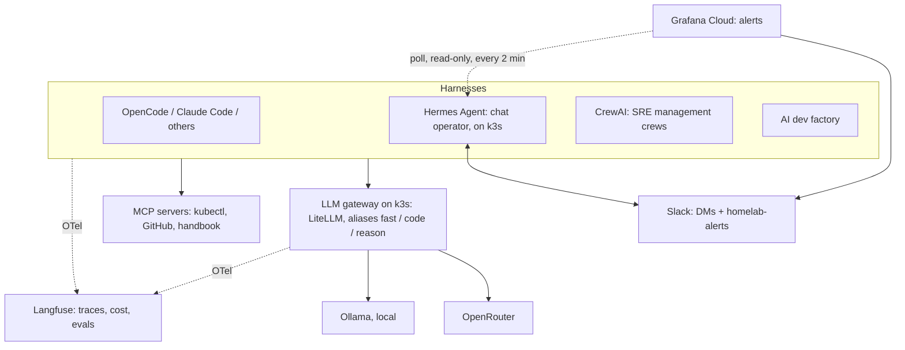

# AI tooling stack

## Rule zero: depend on standards, not products

Every piece below can be swapped, because the stack only depends on open interfaces:

| Concern | Standard we code against | Products are just implementations |
|---|---|---|
| Calling models | OpenAI-compatible API, through **our own gateway** with model **aliases** | OpenRouter, direct providers, Ollama |
| Agent instructions | `AGENTS.md` (Claude Code reads it via a one-line `CLAUDE.md`: `@AGENTS.md`) | OpenCode, Codex, Cursor, Copilot, Claude Code, Hermes |
| Reusable agent abilities | Agent Skills (`SKILL.md` folders) | Same harnesses; Hermes says it's agentskills.io-compatible |
| Tools and data access | MCP servers | Any MCP-capable harness or framework |
| Traces, cost, evals | OpenTelemetry | Langfuse, LangSmith, Grafana |
| Dev environments | `devcontainer.json` | DevPod, VS Code, Codespaces, JetBrains |

## Layers

### 1. Model access: OpenRouter behind your own gateway
- **OpenRouter** gives one key and one bill for hundreds of models, including cheap open-weight ones. It charges a 5.5% fee on credit purchases and keeps only metadata by default ([pricing/FAQ](https://openrouter.ai/docs/cookbook/coding-agents/claude-code-integration)).
- **Don't point tools at OpenRouter directly.** Put a **LiteLLM** proxy in front (it runs on k3s now; the laptop Compose file is the fallback, [ADR-0022](../../decisions/0022-llm-gateway-on-k3s.md)). Tools call `http://llm-gateway/v1` with **aliases** instead of vendor model names:
  - `fast`: cheap model for summaries, journaling, classification
  - `code`: strong, cost-competitive coding model
  - `reason`: frontier model for planning and review, used sparingly
  - `local`: Ollama model for offline or private work
- Swapping a model or leaving OpenRouter becomes a gateway config change. The gateway also gives per-key budgets, spend tracking and traces, which is good SRE practice and good portfolio material.
- Pin the gateway image to a specific version or digest and update deliberately; it holds every API key.
- The cluster gateway is the `llm-gateway` Argo CD app; the laptop Compose gateway is the documented fallback. See the [gateway reference](reference-gateway.md) and the [fallback runbook](runbook-gateway-fallback.md).

### 2. Coding harness
- **Default: OpenCode** (open source, any OpenAI-compatible provider, reads `AGENTS.md` and skills). It works with every alias, so cheap models are the default.
- **Claude Code** remains an option, but through OpenRouter it only supports Anthropic models ([OpenRouter docs](https://openrouter.ai/docs/cookbook/coding-agents/claude-code-integration)). Treat it as one harness among several, never a dependency.
- Playbooks, skills and `AGENTS.md` are written so any harness can run them.

### 3. Local automation: Hermes Agent, running on k3s
Hermes is the lab's chat operator ([ADR-0023](../../decisions/0023-hermes-on-k3s-pod-as-sandbox.md)): one pod on k3s, you DM it in Slack, and it posts a first diagnosis for Grafana Cloud alerts. See the [Hermes reference](reference-hermes.md), the [Hermes runbook](runbook-hermes.md), and [how to promote a Hermes-written skill](howto-promote-hermes-skill.md). This supersedes the earlier "local automation on the laptop" plan ([ADR-0009](../../decisions/0009-hermes-for-local-automation.md)).

Guardrails that matter:
- **The pod is the sandbox.** Commands run in Hermes' own container; a read-only ServiceAccount (no Secrets, no `exec`, no writes) and a NetworkPolicy that keeps it off the home LAN. It **proposes** changes rather than making them.
- **Policy comes from Git** through a read-only managed ConfigMap Hermes can't edit (model, approval mode, disabled toolsets, webhook routes).
- **Approvals on:** dangerous commands wait for a "yes" in Slack; unattended sessions (cron, webhook) deny them outright.
- **Skills are code, reviewed.** Hermes reads `homelab-agents` via git-sync; skills it writes wait for `/skills approve` and become a PR before they take effect.
- **Alerts get a first diagnosis** by polling Grafana Cloud every 2 minutes — no inbound path, no model cost while quiet ([ADR-0024](../../decisions/0024-alerts-to-hermes-by-polling-then-in-cluster-webhook.md)).
- **Memory lives in SQLite**, not Markdown. Treat it as a cache; anything worth keeping gets promoted to the handbook.

### 4. SRE management agents: CrewAI
Reasonable choice: open-source core, role-based crews map naturally to SRE roles (triager, investigator, scribe), and it supports many model providers. To stay portable:
- Put the real capabilities in **MCP servers and skills** (query metrics, read runbooks, open incidents). CrewAI only orchestrates them, so moving to LangGraph or another framework later doesn't mean rewriting tools.
- Watch for its limits on long-running, stateful, human-in-the-loop workflows; LangGraph is the usual alternative there. This is tracked as an open question.

### 5. AI dev factory: LangSmith vs Langfuse
**LangSmith is an observability and evaluation platform, not a factory.** It's proprietary; only its SDKs are MIT, and self-hosting needs an Enterprise contract. The open framework from the same company is **LangGraph**.
**Langfuse** covers the same ground (traces, prompts, evals, cost), has an MIT-licensed core, self-hosts on k3s, and accepts OpenTelemetry. It was acquired by ClickHouse in January 2026 and says licensing is unchanged ([comparison](https://langwatch.ai/blog/langfuse-vs-langsmith)).
**Decided: Langfuse, self-hosted** ([ADR-0010](../../decisions/0010-langfuse-for-tracing-and-evals.md)). Traces go over OpenTelemetry, so LangSmith's free tier can still be added or swapped in later with configuration only.

## Keeping costs low
- Default every agent to `fast` or `code`; reserve `reason` for planning and review steps.
- Set gateway budgets per key (per harness, per crew).
- Cache and summarize context: playbooks load only the ADRs and pages a step links, not the whole handbook.
- Track spend per playbook run in Langfuse and publish the numbers. "Built X for $Y in model costs" is a strong post.
