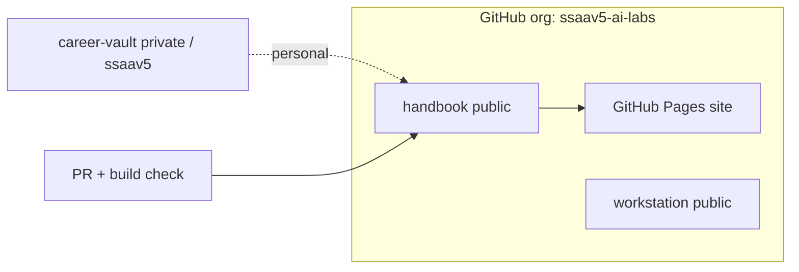

# Github

The lab runs on a free GitHub organization that is configured the way an enterprise would run it: two-factor authentication required, teams, a protected `main` branch, and security scanning enabled on every repo.

## What exists

- **Organization** `ssaav5-ai-labs` (Free plan) — 2FA required for members, base permission `read`.
- **Teams** `platform` and `sre`. `sre` owns `docs/decisions/` and `docs/open-questions/` via [`CODEOWNERS`](https://github.com/ssaav5-ai-labs/handbook/blob/main/.github/CODEOWNERS).
- **Repos**
  - `handbook` (public) — this knowledge base; source of the [published site](https://ssaav5-ai-labs.github.io/handbook/).
  - `workstation` (public) — base dev container, LLM gateway, local AI services.
  - `career-vault` (private, personal account `ssaav5`) — not public-safe material.
- **Branch ruleset** `protect-main` on the handbook: PR required, `build` status check required, force-push/deletion blocked, linear history. See [howto-rulesets](howto-rulesets.md).
- **Security** Dependabot alerts + security updates, secret scanning and push protection enabled on the handbook.

## How it fits

One org, one place for rulesets, teams, Actions secrets and the planning board. The handbook is the single system of record (ADR-0003); code repos hold only a README and `AGENTS.md` pointing here.

## Diagram

## Links

- Decisions: [ADR-0004](../../decisions/0004-github-free-org-public-repos.md) (free org, public repos), [ADR-0011](../../decisions/0011-github-org-name.md) (org name).
- How-tos: [howto-rulesets](howto-rulesets.md).
- Playbook: [01-github-foundation](../../playbooks/index.md).
