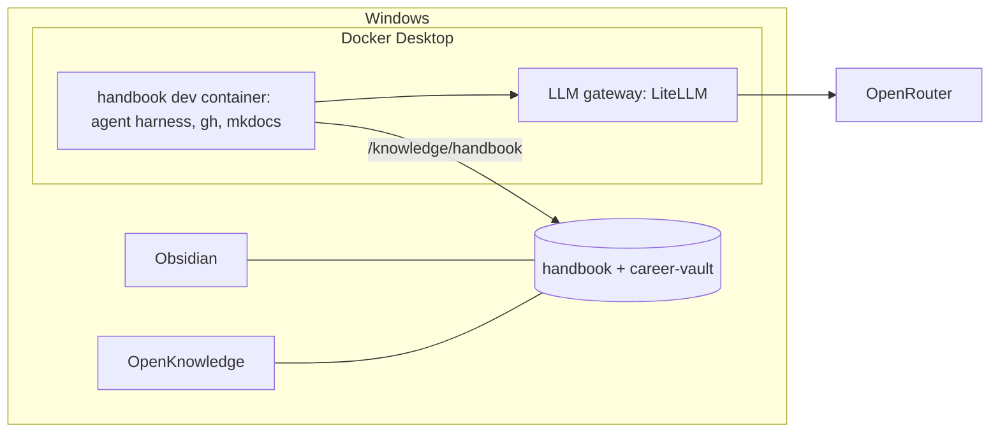

# Set up the workstation and start capturing knowledge

## What you'll have at the end
Your laptop runs everything in containers: an AI coding agent that works with any model, a local LLM gateway that keeps costs visible and providers swappable, and the handbook open in both Obsidian and OpenKnowledge. From this point on, every playbook records what you did and why, automatically.



## Before you start 🧑
The agent checks what it can from inside the container and only asks about the rest: the key with `echo ${OPENROUTER_API_KEY:+set}`, the handbook copy by the fact that `/workspaces/handbook` exists. Git for Windows and the OpenRouter account it has to ask about.

- [x] Docker Desktop installed and running (it uses WSL2 underneath).
- [x] DevPod installed, with the Docker provider: `devpod provider add docker`.
- [ ] **Windows only:** make the `devpod` command work. The desktop app ships its CLI as `devpod-cli.exe`, so point an alias at the app's own file (updates are picked up automatically, nothing to copy). In PowerShell:
  ```
  Set-ExecutionPolicy -Scope CurrentUser RemoteSigned
  if (!(Test-Path $PROFILE)) { New-Item -Force $PROFILE | Out-Null }
  Add-Content $PROFILE 'Set-Alias devpod "$env:LOCALAPPDATA\DevPod\devpod-cli.exe"'
  ```
  Open a new PowerShell window and check `devpod version`. (The first line lets PowerShell load your own profile script; Windows blocks all scripts by default.)
- [x] Obsidian and OpenKnowledge installed.
- [ ] Git for Windows installed (`git --version` works in PowerShell).
- [ ] An OpenRouter account with a few dollars of credit, and an API key with a **monthly limit** set on the key.
- [ ] In PowerShell, set the key for this bootstrap: `setx OPENROUTER_API_KEY "<key>"`, then open a new terminal.
- [ ] A copy of this handbook folder somewhere on the laptop (download from the project, or clone once it's on GitHub).

## Kick it off
1. 🧑 In PowerShell, from the handbook folder: `devpod up . --ide vscode` (or `--ide none` and `devpod ssh handbook`).
2. 🧑 In the container terminal, start the agent: `opencode` (it uses `OPENROUTER_API_KEY` for this first run only; step 4 moves it to the gateway).
   *Windows fallback:* if `devpod ssh` fails with "The parameter is incorrect", open the container with Docker instead. The container ID changes whenever the container is rebuilt, so look it up each time:
   ```
   $c = docker ps --format "{{.ID}} {{.Image}}" | Select-String "vsc-handbook" | ForEach-Object { $_.Line.Split(" ")[0] } | Select-Object -First 1
   docker exec -it -u vscode -w /workspaces/handbook $c bash
   ```
3. Paste:

> Run the playbook `playbooks/00-workstation-knowledge`.

## Steps

### 1. Choose names
**Why:** Folder paths, repo URLs and the site address all use the org name. It's already decided: `ssaav5-ai-labs` (ADR-0011).
**Questions:** Your GitHub username (for the career vault path and commit settings).
**Actions:** Confirm `github.com/ssaav5-ai-labs` is still unclaimed (it's created in playbook 01).
**Verify:** `curl -s -o /dev/null -w "%{http_code}" https://github.com/ssaav5-ai-labs` returns `404`.
**Record:** Nothing new; ADR-0011 already covers it.

### 2. Put the handbook in its permanent place 🧑
**Why:** ADR-0006 puts knowledge repos on the Windows side so Obsidian and OpenKnowledge open them natively.
**Check first:** ask which Windows folder the handbook was unzipped to. If it is already `$env:USERPROFILE\code\github.com\ssaav5-ai-labs\handbook` and the container was started from that folder, there is nothing to do: report "already done" and go to step 3. Do not suggest deleting the workspace, because that destroys the running container and this session.
**You do (only if it is somewhere else):** move the folder to `$env:USERPROFILE\code\github.com\ssaav5-ai-labs\handbook`, then `devpod delete handbook` and `devpod up . --ide none` from the new location. This ends the current session; restart the agent and rerun the playbook, which resumes at step 3.
**Verify:** the handbook is at the canonical path (the user confirms), and `git -C /workspaces/handbook status` runs inside the container once step 3 has created the repo.

### 3. Start version control
**Why:** Everything from here on is history worth keeping.
**Questions:** Name for commits (ask, don't assume the username), and email (recommended: GitHub's no-reply address from GitHub → Settings → Emails, e.g. `12345678+user@users.noreply.github.com`, to keep your email out of a public repo).
**Actions:** `git init -b main`; set `user.name`, `user.email`, `core.fileMode false` and `core.autocrlf input` for this repo; first commit.
**Gotchas:** The folder is mounted from Windows and owned by another user, so git may report `fatal: not in a git directory` or "dubious ownership". The fix is `git config --global --add safe.directory /workspaces/handbook` (the dev container now does this automatically). Without `core.fileMode false`, every file is committed as executable.
**Verify:** `git log --oneline` shows one commit, and `git ls-files -s | grep -c ^100755` counts only real scripts (just `scripts/sync-skills.sh`).

### 4. Run the LLM gateway
**Why:** ADR-0008: every tool calls one local endpoint with aliases, so models and providers can change without touching anything else.
**Questions:** Which OpenRouter models back each alias (`fast`, `code`, `reason`). The agent looks up current OpenRouter prices (per-provider endpoints, `https://openrouter.ai/api/v1/models/<id>/endpoints`) and proposes a model per role; you confirm. Judge by cost per finished task, not price per token: rework from a weak model costs more than the token savings. Quote typical provider prices, not the single cheapest endpoint, and only count endpoints that support tools. Monthly budget for the gateway (recommended: same as the OpenRouter key limit).
**Actions:** Configure OpenRouter provider preferences in the gateway: require tool support and exclude fp4/int4 quantizations, so routing never silently picks the weakest endpoint. Create the `workstation` repo next to the handbook (`...\github.com\ssaav5-ai-labs\workstation`) with `gateway/compose.yaml` and `gateway/config.yaml` for LiteLLM (pinned image tag, aliases, budget, a master key from `.env`, which is git-ignored). 🧑 You run `docker compose up -d` in `gateway/` from PowerShell.
**Verify:** `LLM_GATEWAY_URL` is `http://host.docker.internal:4000` (the gateway as seen from inside containers). From the container, a request to `${LLM_GATEWAY_URL}/v1/models` lists the four aliases, and a one-line chat call to `fast` succeeds.
**Record:** `docs/domains/ai-stack/reference-gateway.md` (aliases, chosen models, prices at time of choice).

### 5. Point the agent at the gateway
**Why:** Removes the last direct dependency on OpenRouter.
**Actions:** Write a project-level `opencode.json` in the repo root (not the global `~/.config/opencode`, which is lost on rebuild): provider `gateway` using `@ai-sdk/openai-compatible`, `baseURL` `{env:LLM_GATEWAY_URL}/v1`, `apiKey` `{env:LLM_GATEWAY_KEY}`, models `fast`/`code`/`reason`, default `gateway/code`. Commit it. The dev container passes the variables in with `containerEnv` (not `remoteEnv`, which `docker exec` sessions don't receive). 🧑 You set `LLM_GATEWAY_URL` and `LLM_GATEWAY_KEY` with `setx`, remove `OPENROUTER_API_KEY` from your environment, and rebuild the container (`devpod up . --recreate`).
**Before the rebuild:** the agent's conversation history lives in a Docker volume (`opencode-data`), so it survives `--recreate`. Afterwards, open the container in `/workspaces/handbook` and run `opencode --continue`; if history is missing (older containers didn't have the volume), start `opencode` and paste the kickoff prompt again. Steps verify before acting, so the run resumes at step 5.
**Verify:** `echo $OPENROUTER_API_KEY` is empty inside the container and the agent still answers.

### 6. Connect the editors
**Why:** Obsidian is for your own thinking and the career vault; OpenKnowledge gives agents MCP access and a WYSIWYG view of the handbook.
**Questions:** Primary editor for the handbook (recommended: OpenKnowledge for the handbook, Obsidian for the career vault; both can open both).
**Actions:** Run `ok init` in the handbook and review what it adds before committing (keep its MCP/skills config only if it doesn't hard-code a vendor). Add an `.obsidian/` entry to `.gitignore` except for shared settings you choose to keep.
🧑 **You do:** Open the folder as a vault in Obsidian; open it in OpenKnowledge.
**Verify:** A test note edited in either editor shows up in `git status`.

### 7. Create the career vault 🧑
**Why:** ADR-0005: private, personally owned notes, with the same schema so content can be promoted to the handbook.
**Important:** the container can only see the handbook folder, so the agent must not create the vault itself; anything it creates elsewhere lives inside the container and is invisible to Obsidian.
**Actions:** The agent prints PowerShell commands for you to run that create `$env:USERPROFILE\code\github.com\<your-username>\career-vault` with `journal/`, `decisions/`, `incidents/`, `frameworks/`, `agent-patterns/`, `brag/`, `drafts/`, copy `templates\` from the handbook, write a `.gitignore` (`.obsidian/workspace*.json`, `.trash/`), and run `git init -b main` plus a first commit with the same name/email as step 3.
🧑 **You do:** Run them, then in Obsidian: vault icon (bottom left) → **Open another vault** → **Open folder as vault** → pick the folder.
**Verify:** In PowerShell, `Test-Path $env:USERPROFILE\code\github.com\<your-username>\career-vault\.git` prints `True`, and the vault opens in Obsidian.

### 8. Base dev container for code repos
**Why:** Every future repo (infra, gitops, agents, products) starts from the same toolset and mounts the handbook, so agents always have context.
**Questions:** Extra tools now or later (recommended now: kubectl, helm, opentofu, sops, age, k9s).
**Actions:** The `workstation` repo is not mounted in the handbook container, so write the template to a scratch folder (not `docs/`, which gets published) and print the PowerShell commands that copy it to `workstation/devcontainer/`. The workstation repo is the only copy; the handbook links to it.
- kubectl and helm through the official feature, pinned in `devcontainer.json` (an ARG in the Dockerfile doesn't cover features): `"ghcr.io/devcontainers/features/kubectl-helm-minikube:1": { "version": "<k3s minor you plan to run>", "helm": "<x.y.z>", "minikube": "none" }`.
- opentofu, sops, age and k9s in the `Dockerfile` from their GitHub release archives, each with an `ARG <TOOL>_VERSION`. Check each version exists on its releases page before writing it. Keep the binary names (`tofu`, not `opentofu`). Skip the opentofu install script: its standalone mode needs cosign or gpg to verify.
- The agent harness (`opencode-ai@<pinned>`), the gateway `containerEnv`, the `opencode-data` volume and the git settings from step 3, same as the handbook's own `devcontainer.json`.
- Handbook bind mount at `/knowledge/handbook`.
**Verify 🧑:** The agent can't run this from inside its own container. It prints these for the human to run in **PowerShell on Windows**, and doesn't mark the step complete until they pass:
```powershell
$t = "$env:USERPROFILE\code\scratch\devcontainer-test"
New-Item -ItemType Directory -Force "$t\.devcontainer" | Out-Null
Copy-Item "$env:USERPROFILE\code\github.com\ssaav5-ai-labs\workstation\devcontainer\*" "$t\.devcontainer\"
devpod up $t --ide none
$id = docker ps -lq
docker exec -it -u vscode $id bash -lc "ls /knowledge/handbook/docs && kubectl version --client && helm version && tofu version && sops --version && age --version && k9s version"
devpod delete devcontainer-test
```
**Record:** `docs/domains/workstation/index.md` (what's installed, pinned versions and why), `howto-new-repo-devcontainer.md`.

### 9. First capture
**Why:** Proves the habit works end to end.
**Actions:** Write today's journal entry from this run (including the real spend from OpenRouter Activity), update the playbook catalog status, set `blog: candidate`, commit.
**Verify:** `mkdocs build --strict` passes. The agent runs build, never a background `mkdocs serve`, which ties up its shell. A live preview is optional: the human runs `mkdocs serve -a 0.0.0.0:8000` in a second shell and opens `http://localhost:8000/handbook/` (the path comes from `site_url`). Port forwarding may not happen when the container was started with `--ide none` and you are attached through `docker exec`; the published site from playbook 01 is the preview that counts.

## When it's done
- Docs updated: workstation and ai-stack domains, journal, decision log.
- Next playbook: [01 GitHub organization + publish](../01-github-foundation/PLAYBOOK.md).

## Video
Not recorded yet. Good first candidate: steps 4-5 ("a vendor-neutral LLM gateway on a laptop in 10 minutes").
