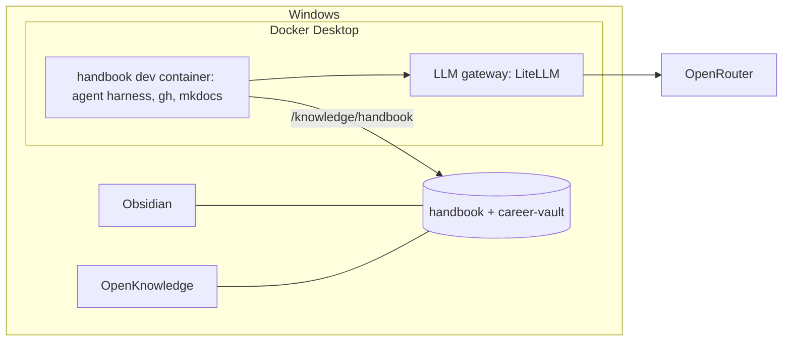

# Set up the workstation and start capturing knowledge

## What you'll have at the end
Your laptop runs everything in containers: an AI coding agent that works with any model, a local LLM gateway that keeps costs visible and providers swappable, and the handbook open in both Obsidian and OpenKnowledge. From this point on, every playbook records what you did and why, automatically.

## Before you start 🧑
- [x] Docker Desktop installed and running (it uses WSL2 underneath).
- [x] DevPod installed, with the Docker provider: `devpod provider add docker`.
- [x] Obsidian and OpenKnowledge installed.
- [ ] Git for Windows installed (`git --version` works in PowerShell).
- [ ] An OpenRouter account with a few dollars of credit, and an API key with a **monthly limit** set on the key.
- [ ] In PowerShell, set the key for this bootstrap: `setx OPENROUTER_API_KEY "<key>"`, then open a new terminal.
- [ ] A copy of this handbook folder somewhere on the laptop (download from the project, or clone once it's on GitHub).

## Kick it off
1. 🧑 In PowerShell, from the handbook folder: `devpod up . --ide vscode` (or `--ide none` and `devpod ssh handbook`).
2. 🧑 In the container terminal, start the agent: `opencode` (it uses `OPENROUTER_API_KEY` for this first run only; step 4 moves it to the gateway).
3. Paste:

> Run the playbook `playbooks/00-workstation-knowledge`.

## Steps

### 1. Choose names
**Why:** Folder paths, repo URLs and the site address all use the org name. It's already decided: `ssaav5-ai-labs` (ADR-0011).
**Questions:** Your GitHub username (for the career vault path and commit settings).
**Actions:** Confirm `github.com/ssaav5-ai-labs` is still unclaimed (it's created in playbook 01).
**Verify:** `curl -s -o /dev/null -w "%{http_code}" https://github.com/ssaav5-ai-labs` returns `404`.
**Record:** Nothing new; ADR-0011 already covers it.

### 2. Put the handbook in its permanent place 🧑
**Why:** ADR-0006 puts knowledge repos on the Windows side so Obsidian and OpenKnowledge open them natively.
**You do:** Move the folder to `$env:USERPROFILE\code\github.com\ssaav5-ai-labs\handbook`, run `devpod delete handbook`, then `devpod up` again from the new location.
**Verify:** Agent runs `git -C . status` (after it initializes the repo in the next step) and `pwd` shows the workspace.

### 3. Start version control
**Why:** Everything from here on is history worth keeping.
**Questions:** Name and email for commits (recommended: GitHub's no-reply address, to keep your email out of a public repo).
**Actions:** `git init -b main`, set user name/email for this repo, first commit.
**Verify:** `git log --oneline` shows one commit.

### 4. Run the LLM gateway
**Why:** ADR-0008: every tool calls one local endpoint with aliases, so models and providers can change without touching anything else.
**Questions:** Which OpenRouter models back each alias (`fast`, `code`, `reason`). The agent looks up current OpenRouter prices and proposes the cheapest model that fits each role; you confirm. Monthly budget for the gateway (recommended: same as the OpenRouter key limit).
**Actions:** Create the `workstation` repo next to the handbook (`...\github.com\ssaav5-ai-labs\workstation`) with `gateway/compose.yaml` and `gateway/config.yaml` for LiteLLM (pinned image tag, aliases, budget, a master key from `.env`, which is git-ignored). 🧑 You run `docker compose up -d` in `gateway/` from PowerShell.
**Verify:** `LLM_GATEWAY_URL` is `http://host.docker.internal:4000` (the gateway as seen from inside containers). From the container, a request to `${LLM_GATEWAY_URL}/v1/models` lists the four aliases, and a one-line chat call to `fast` succeeds.
**Record:** `docs/domains/ai-stack/reference-gateway.md` (aliases, chosen models, prices at time of choice).

### 5. Point the agent at the gateway
**Why:** Removes the last direct dependency on OpenRouter.
**Actions:** Write OpenCode config for an OpenAI-compatible provider at the gateway, default model `code`. 🧑 You set `LLM_GATEWAY_URL` and `LLM_GATEWAY_KEY` with `setx`, remove `OPENROUTER_API_KEY` from your environment, and rebuild the container (`devpod up . --recreate`).
**Verify:** `echo $OPENROUTER_API_KEY` is empty inside the container and the agent still answers.

### 6. Connect the editors
**Why:** Obsidian is for your own thinking and the career vault; OpenKnowledge gives agents MCP access and a WYSIWYG view of the handbook.
**Questions:** Primary editor for the handbook (recommended: OpenKnowledge for the handbook, Obsidian for the career vault; both can open both).
**Actions:** Run `ok init` in the handbook and review what it adds before committing (keep its MCP/skills config only if it doesn't hard-code a vendor). Add an `.obsidian/` entry to `.gitignore` except for shared settings you choose to keep.
🧑 **You do:** Open the folder as a vault in Obsidian; open it in OpenKnowledge.
**Verify:** A test note edited in either editor shows up in `git status`.

### 7. Create the career vault
**Why:** ADR-0005: private, personally owned notes, with the same schema so content can be promoted to the handbook.
**Actions:** Create `$env:USERPROFILE\code\github.com\<your-username>\career-vault` with `journal/`, `decisions/`, `incidents/`, `frameworks/`, `agent-patterns/`, `brag/`, `drafts/`, a copy of `templates/`, and `git init`.
🧑 **You do:** Open it as a second Obsidian vault.
**Verify:** `git -C <path> log` shows the first commit.

### 8. Base dev container for code repos
**Why:** Every future repo (infra, gitops, agents, products) starts from the same toolset and mounts the handbook, so agents always have context.
**Questions:** Extra tools now or later (recommended now: kubectl, helm, opentofu, sops, age, k9s).
**Actions:** In `workstation/devcontainer/`, add a `devcontainer.json` template and `Dockerfile` with those tools, the agent harness, and a mount of the handbook at `/knowledge/handbook`.
**Verify:** `devpod up` on the template starts, and `ls /knowledge/handbook/docs` works inside it.
**Record:** `docs/domains/workstation/index.md` (what's installed and why), `howto-new-repo-devcontainer.md`.

### 9. First capture
**Why:** Proves the habit works end to end.
**Actions:** Write today's journal entry from this run, update the playbook catalog status, set `blog: candidate`, commit.
**Verify:** `mkdocs serve` shows the entry at `http://localhost:8000`.

## When it's done
- Docs updated: workstation and ai-stack domains, journal, decision log.
- Next playbook: [01 GitHub organization + publish](../01-github-foundation/PLAYBOOK.md).

## Video
Not recorded yet. Good first candidate: steps 4-5 ("a vendor-neutral LLM gateway on a laptop in 10 minutes").
